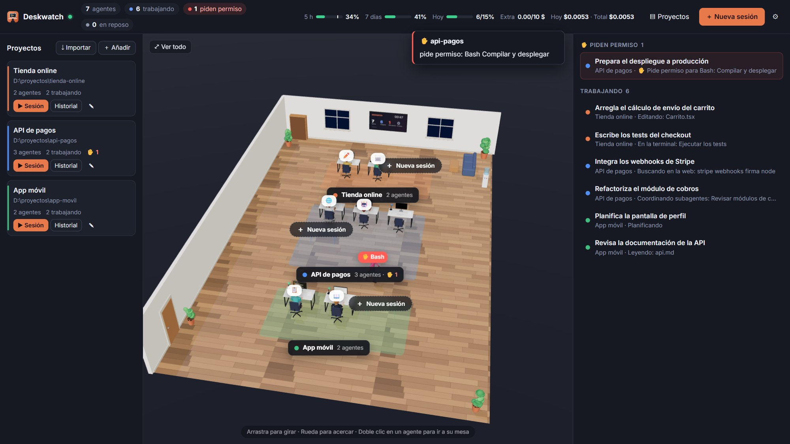

# Deskwatch

**Tus agentes de Claude Code, trabajando a la vista.** · *Your Claude Code agents, working in plain sight.*

Deskwatch es una app de escritorio para Windows que convierte cada sesión de Claude Code en una persona sentada en su mesa, dentro de una oficina en 3D. Desde ella ves lo que hace cada agente, respondes a sus permisos, chateas con él (imágenes, PDF, comandos) y controlas el consumo de tu plan con frenos y presupuestos.

> 🚧 **En desarrollo.** Todavía no hay descarga pública. Dale a **Watch → Custom → Releases** para enterarte cuando salga.

Este repositorio contiene la página de presentación: **https://davidrfyt.github.io/deskwatch/**

---

Claude y Claude Code son marcas de Anthropic. Deskwatch es un proyecto independiente y no está afiliado a Anthropic ni cuenta con su respaldo.
