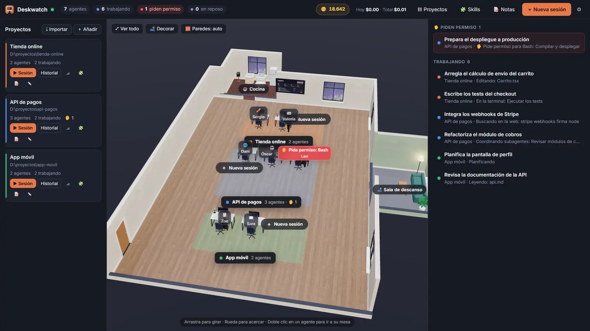

# Deskwatch

**Your Claude Code agents, working in plain sight.**

Deskwatch is a Windows desktop app that turns every Claude Code session into a person at a desk in a 3D office. See what each agent is doing at a glance, approve permission requests, chat with them (images, PDFs, slash commands), and keep your plan usage in check with limits and budgets.

**[⬇ Download for Windows](https://github.com/davidrfyt/deskwatch/releases/latest)** · **[Website](https://davidrfyt.github.io/deskwatch/)**

## Features

- **A live 3D office.** One character per session, sitting, typing, thinking or taking a coffee break depending on what the agent is doing. Each monitor shows that agent's chat as it happens.
- **Permissions without switching windows.** When an agent needs approval, its desk lights up and you answer from the office.
- **Full chat and control.** Start, resume and steer sessions, attach images and PDFs, run slash commands, and enable Remote Control.
- **Usage limits.** Daily and per-project budgets and an emergency brake, so you always know what your plan is spending.
- **Make it yours.** 64 customizable characters, buildable rooms (bathroom, kitchen, meeting and break rooms) and furniture to decorate the office.
- **Works with your existing setup.** Also follows the sessions you open from the terminal or VS Code, and installs skills from a GitHub link.
- **Automatic updates.** New versions download in the background and install on restart.

## Requirements

- Windows 10 or 11 (64-bit)
- [Claude Code](https://claude.com/claude-code) installed and signed in

## Installation

1. Download `Deskwatch-Setup-x.y.z.exe` from the [latest release](https://github.com/davidrfyt/deskwatch/releases/latest).
2. Run it and follow the installer. Windows SmartScreen may ask for confirmation the first time.
3. Open Deskwatch. The first-run guide checks that everything is ready.

From then on, Deskwatch updates itself.

## About this repository

This repository hosts the project website (GitHub Pages) and the Windows installers published as [Releases](https://github.com/davidrfyt/deskwatch/releases). The app's source code is not public.

---

*Claude and Claude Code are trademarks of Anthropic. Deskwatch is an independent project and is not affiliated with or endorsed by Anthropic.*
